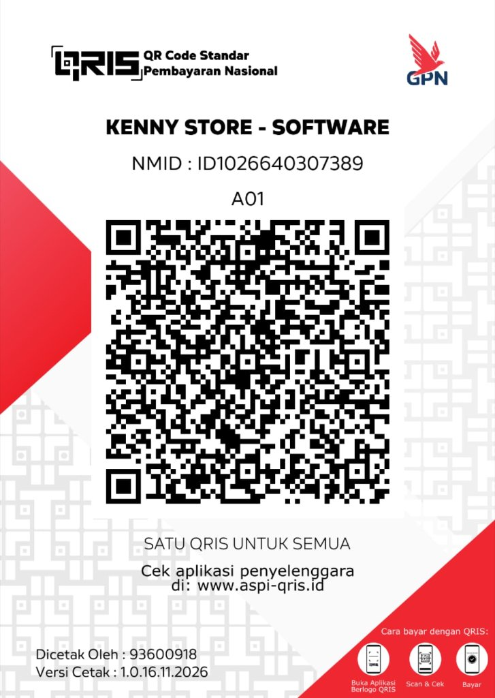

# BYD Maps Patches

Google Maps-only Morphe patch bundle for **Android Auto** that displays your BYD's live state of charge and estimated arrival battery (`86% → 11%`) from [byd-open-remote](https://github.com/kennyric/byd-open-remote), while keeping Google Maps' **Material You** design.

Forked from [nl-morphe-patches](https://gitlab.com/johninnld/nl-morphe-patches) and narrowed down to **Google Maps only** (GPL-3.0).

---

## Quick Start: Add Repo to Morphe

### Option 1 — Morphe Manager (on Android)
1. Install **[Morphe Manager](https://morphe.software/)**.
2. Add this repository as a patch source (either method):
   - **One-tap**: Open `https://morphe.software/add-source?github=kennyric/byd-maps-patches` on your phone.
   - **Manual**: Switch to the **Sources** tab, tap **`+`**, and paste:
     ```
     https://github.com/kennyric/byd-maps-patches
     ```
3. Select **Google Maps** in Morphe Manager and follow its prompt to fetch the matching original app.
   Morphe knows this bundle is pinned to **Google Maps `26.44.06.1006895251`** (versionCode `1068856906`, `minSdk 29`) and guides you to that exact build, so you do not need to hunt for it on APKMirror yourself.
4. Keep the default patches (which include **`BYD battery and range in the navigation card`** and **`Native navigation for any Android Auto host`**), and patch.
   - *Optional*: Enable **`Add microG-RE support`** if you want Google account sign-in via MicroG-RE (package becomes `org.ungoogled.android.apps.maps.microg`).
   - *Material You*: `Black theme`, `Rectangle shapes`, and `Zoom controls in navigation` are **off by default** so Maps keeps its rounded Material You look.
5. **Reinstall the patched APK through KingInstaller** before using it in the car — see [Android Auto setup](#android-auto--byd-open-remote-setup). A normal install works on the phone, but Android Auto only lists navigation apps that were installed as if from Google Play.

### Option 2 — Morphe Desktop CLI (on PC)
Download the latest `patches-*.mpp` from [Releases](https://github.com/kennyric/byd-maps-patches/releases/latest) and run:
```bash
java -jar morphe-desktop-2.2.0-all.jar patch \
  -p patches-1.93.0.mpp \
  -o maps-byd.apk \
  GoogleMaps_26.44.06.apk
```

---

## Android Auto & `byd-open-remote` Setup

1. **Install `byd-open-remote` (`≥ 1.1.0`)** on your phone and sign in to your BYD account.
   - If you enabled `Add microG-RE support`, set the target package in `byd-open-remote` to `org.ungoogled.android.apps.maps.microg` (otherwise the default `org.ungoogled.android.apps.maps` matches).
2. **Install [KingInstaller](https://github.com/fcaronte/KingInstaller/releases/latest) and [Shizuku(-Next)](https://github.com/rushiranpise/Shizuku-Next/releases/latest)** on the phone. Root is not required.
3. **Start Shizuku**, then open KingInstaller, enable its **Shizuku** switch, and allow the access prompt. Leave **Root** off.
4. **Reinstall the patched Maps APK through KingInstaller.** In Morphe's finished patching screen tap **Install**, choose **KingInstaller**, then tap **Install as king**.
   - If KingInstaller is not offered in the chooser, export the patched APK from Morphe, open KingInstaller, select that APK, and continue with **Install as king**.
   - This step is what makes Android Auto list the app: KingInstaller records Google Play Store as the installer, while a normal install records Morphe or your file manager and Android Auto hides the app.
   - ADB alternative: `adb install -i com.android.vending -r maps-byd.apk`
5. Open phone **Settings → Android Auto → Customize launcher** and enable **Ungoogled Maps**. If it is still missing, force-stop `com.google.android.projection.gearhead` or unplug and replug the phone.
6. Repeat the KingInstaller reinstall after every patched update — a normal install can change the recorded installer again.

---

## How the BYD Battery Pill Works

- **Dynamic Day/Night pill**: During active navigation on Android Auto, a rounded Material pill sits above the bottom-left ETA card (`current% → arrival%`), automatically adapting to Day (frosted white) and Night (dark slate) with green (`≥ 30%`), amber (`15–29%`), and red (`< 15%`) SoC text.
- **Freshness**: Data older than 15 minutes is hidden automatically so stale readings are never shown.
- **Diagnostics**:
  ```bash
  adb logcat -s BydTelemetry BydVehicle
  ```

---

## Support

**BYD Maps Patches** is free and open-source. If this patch bundle makes your drive easier, you can support ongoing development:

[](https://ko-fi.com/kenny40049)

### QRIS



---

## License

GPL-3.0 — see [LICENSE](LICENSE). Upstream Android Auto navigation adapter and base Maps patches by [johninnl / nl-morphe-patches](https://gitlab.com/johninnld/nl-morphe-patches).
